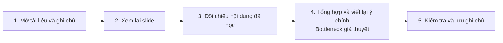
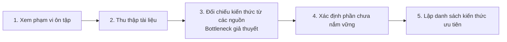
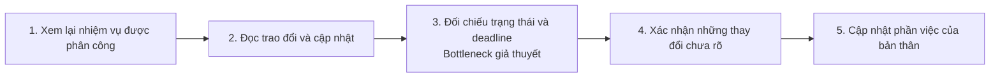

# Báo cáo cá nhân — 2A202603722_MaiXuanKhang

## 1. Thông tin học viên

- Họ tên: Mai Xuân Khang
- MSSV: 2A202603722
- Lớp: L3B
- Tên nhóm: D2
- Link repo nhóm: [Fork của nhóm](https://github.com/minhquannm0905-cloud/K5-L3B-Day02-D2-DiscoverProblemFraming)

---

## 2. Scan problem (CP1)

Lăng kính: **Lặp lại** · **Tốn thời gian** · **Cần đọc, tổng hợp nhiều thông tin** · **Pain từ người khác**.

| # | Lăng kính | Job Story: Khi… tôi muốn… để… | Ai chịu ảnh hưởng? | Dấu hiệu thật (thời gian, tần suất, số người, bằng chứng) |
| --- | --- | --- | --- | --- |
| 1 | Cần đọc, tổng hợp nhiều thông tin | Khi chuẩn bị ôn thi từ nhiều nguồn tài liệu, tôi muốn xác định nhanh các kiến thức trọng tâm và nội dung còn thiếu, để ôn tập hiệu quả hơn. | Bản thân tôi, sinh viên đang ôn thi từ nhiều nguồn. | Nội dung có thể nằm rải rác trong slide, bài tập, ghi chú và tài liệu tham khảo. |
| 2 | Lặp lại | Khi kết thúc mỗi buổi học, tôi muốn tổng hợp nội dung quan trọng từ bài giảng và slide, để dễ dàng xem lại kiến thức mà không phải đọc hoặc nghe lại toàn bộ. | Bản thân tôi, sinh viên tổng hợp ghi chú sau buổi học. | Khi tổng hợp ghi chú, có thể phải xem lại slide hoặc phần giảng ở những chỗ chưa rõ. |
| 3 | Tốn thời gian | Khi thực hiện bài tập hoặc nhiệm vụ học tập có nhiều yêu cầu, tôi muốn nhanh chóng xác định nội dung mình đã hiểu sai hoặc thực hiện thiếu, để sửa bài chính xác mà không phải kiểm tra lại toàn bộ từ đầu. | Bản thân tôi, sinh viên rà bài. Giảng viên hướng dẫn bài tập cũng có thể bị ảnh hưởng khi cần giải thích lại đề. | Có thể phải rà lại chỗ hiểu sai đề hoặc bỏ sót tiêu chí. Giảng viên có thể phải giải thích lại yêu cầu. |
| 4 | Lặp lại | Khi tham gia dự án hoặc bài tập nhóm có nhiều thành viên, tôi muốn theo dõi nhiệm vụ, tiến độ và các thay đổi, để tránh bỏ sót công việc hoặc trễ deadline. | Bản thân tôi, sinh viên phụ trách một phần bài tập nhóm. | Nhiệm vụ, hạn và thay đổi có thể nằm rải rác trong chat, tài liệu và bảng phân công. |
| 5 | Pain từ người khác | Khi cần tìm lại thông tin hoặc hướng dẫn đã được chia sẻ trước đó, tôi muốn truy xuất đúng nội dung nhanh chóng, để không mất thời gian tìm kiếm trong nhiều tài liệu và cuộc hội thoại. | Bản thân tôi, sinh viên tìm lại hướng dẫn. Giảng viên phụ trách học phần cũng có thể nhận câu hỏi lặp lại. | Hướng dẫn có thể nằm rải rác trong LMS, email, nhóm chat hoặc slide. Nếu chưa tìm được, sinh viên có thể phải hỏi lại giảng viên hoặc bạn học. |

---

## 3. Top 3 Problem Cards + quy trình nháp (CP2)

Các sơ đồ mô tả quy trình hiện tại và đánh dấu bước nghẽn giả thuyết. Mục tiêu thời gian trong từng card dùng để đánh giá mức cải thiện khi có số đo thực tế.

### Bảng chọn top 3

| Rank | Problem | Vì sao chọn | Câu hỏi phân tích |
| --- | --- | --- | --- |
| 1 | Tổng hợp kiến thức sau buổi học (CP1 #2) | Có thể giới hạn trong một buổi học và đối chiếu ghi chú với mục tiêu của buổi đó. | Phần viết lại hay phần tra nội dung chưa rõ tốn nhiều thời gian hơn? |
| 2 | Tổng hợp tài liệu ôn tập từ nhiều nguồn (CP1 #1) | Có thể giới hạn trong một học phần và đối chiếu danh sách ưu tiên với phạm vi ôn tập. | Phạm vi ôn tập có đủ rõ để kiểm tra chủ đề còn thiếu không? |
| 3 | Theo dõi tiến độ và phối hợp nhóm (CP1 #4) | Có thể xem lại lịch sử giao việc để xác định thay đổi nào gây hỏi lại hoặc bỏ sót nhiệm vụ. | Mất thời gian vì phải đối chiếu nhiều nơi hay vì phải chờ người xác nhận? |

### Problem Card #1

| Trường | Nội dung |
| --- | --- |
| Job Story | Khi kết thúc mỗi buổi học, tôi muốn tổng hợp nội dung quan trọng từ bài giảng và slide, để dễ dàng xem lại kiến thức mà không phải đọc hoặc nghe lại toàn bộ. |
| Actor | Bản thân tôi, sinh viên đại học tổng hợp bài giảng và slide để ôn lại. |
| Thời điểm / bối cảnh | Sau một buổi học có slide và ghi chú trên lớp. Đầu ra là bản ghi chú dùng để ôn. |
| Quy trình hiện tại (3–7 bước) | Mở tài liệu và ghi chú → xem lại slide → đối chiếu nội dung đã học → viết lại ý chính → kiểm tra và lưu ghi chú. |
| Bottleneck (bước nào, mất bao nhiêu phút) | Bước 4, tổng hợp và viết lại ý chính. Có thể mất thời gian ở khâu chọn ý và diễn đạt lại. |
| Impact (nếu không giải thì sao) | Có thể tốn thêm thời gian xem lại tài liệu khi ôn hoặc bỏ sót ý chính của buổi học. |
| Success metric (baseline → target) | Mục tiêu đề xuất 25–30 phút/buổi. Bấm giờ từ khi mở tài liệu đến khi lưu ghi chú và so các buổi có lượng nội dung tương đương. Đếm số ý chính bị bỏ sót theo mục tiêu bài học, với mục tiêu là 0. |
| Phương án không dùng AI | Dùng mẫu ghi chú thống nhất theo mục tiêu bài học và đánh dấu nội dung quan trọng ngay trong buổi học. |
| Giả thuyết về AI (nếu có) | Nếu bước viết lại vẫn tốn nhiều thời gian, AI có thể giúp sắp xếp ghi chú thành dàn ý. Sinh viên kiểm tra lại các ý chính với slide và ghi chú gốc. |
| Cảm nhận nhanh | Ưu tiên mẫu ghi chú vì có thể chuẩn bị ngay trong buổi học. Cân nhắc hỗ trợ thêm nếu khâu viết lại vẫn là bước nghẽn. |

**Quy trình hiện tại (As-Is)**

### Problem Card #2

| Trường | Nội dung |
| --- | --- |
| Job Story | Khi chuẩn bị ôn thi từ nhiều nguồn tài liệu, tôi muốn xác định nhanh các kiến thức trọng tâm và nội dung còn thiếu, để ôn tập hiệu quả hơn. |
| Actor | Bản thân tôi, sinh viên đại học ôn một học phần có slide, bài tập, ghi chú và tài liệu tham khảo. |
| Thời điểm / bối cảnh | Đầu một phiên chuẩn bị ôn thi, khi cần biết nội dung nào thuộc phạm vi thi và phần nào mình chưa nắm vững. |
| Quy trình hiện tại (3–7 bước) | Xem phạm vi → thu thập tài liệu → đối chiếu kiến thức giữa các nguồn → xác định phần chưa nắm vững → lập danh sách ưu tiên. |
| Bottleneck (bước nào, mất bao nhiêu phút) | Bước 3, đối chiếu kiến thức từ nhiều nguồn. Các nguồn có thể trình bày cùng một chủ đề ở mức độ khác nhau. |
| Impact (nếu không giải thì sao) | Có thể dành nhiều thời gian đọc nội dung trùng lặp hoặc bỏ sót chủ đề cần ôn trước kỳ thi. |
| Success metric (baseline → target) | Mục tiêu đề xuất 35–40 phút/phiên. Bấm giờ từ lúc xem phạm vi đến khi có danh sách ưu tiên. Đối chiếu với phạm vi do giảng viên cung cấp và đếm số chủ đề bị bỏ sót, với mục tiêu là 0. |
| Phương án không dùng AI | Dùng checklist theo từng chủ đề và bảng theo dõi tiến độ ôn tập, có nguồn tài liệu và phần cần luyện thêm. |
| Giả thuyết về AI (nếu có) | Nếu việc ghép chủ đề với tài liệu vẫn tốn thời gian, AI có thể gợi ý mục liên quan trong tài liệu được cung cấp. Sinh viên đối chiếu từng gợi ý với phạm vi ôn tập. |
| Cảm nhận nhanh | Ưu tiên checklist khi phạm vi thi rõ. Nếu phạm vi chưa rõ, cần xác nhận với giảng viên trước khi phân loại tài liệu. |

**Quy trình hiện tại (As-Is)**

### Problem Card #3

| Trường | Nội dung |
| --- | --- |
| Job Story | Khi tham gia dự án hoặc bài tập nhóm có nhiều thành viên, tôi muốn theo dõi nhiệm vụ, tiến độ và các thay đổi, để tránh bỏ sót công việc hoặc trễ deadline. |
| Actor | Bản thân tôi, sinh viên phụ trách một phần bài tập nhóm. |
| Thời điểm / bối cảnh | Trước mốc nộp, khi cần kiểm tra phần việc của mình và các thay đổi nhóm đã thống nhất. |
| Quy trình hiện tại (3–7 bước) | Xem việc đã giao → đọc trao đổi và cập nhật → đối chiếu trạng thái và hạn → xác nhận điểm chưa rõ → cập nhật phần việc của mình. |
| Bottleneck (bước nào, mất bao nhiêu phút) | Bước 3, đối chiếu thông báo và thay đổi để xác định trạng thái và hạn mới nhất. |
| Impact (nếu không giải thì sao) | Có thể bỏ sót nhiệm vụ, làm theo yêu cầu cũ hoặc bàn giao muộn, ảnh hưởng đến phần việc của thành viên khác. |
| Success metric (baseline → target) | Mục tiêu đề xuất 15–20 phút/lần. Bấm giờ từ lúc xem việc được giao đến khi cập nhật xong phần việc và ghi riêng thời gian chờ phản hồi. Đối chiếu với lịch sử giao việc để kiểm đủ nhiệm vụ, người phụ trách và hạn mới nhất, đồng thời ghi số việc bị bỏ sót. |
| Phương án không dùng AI | Dùng bảng phân công chung ghi nhiệm vụ, người phụ trách, trạng thái và hạn. Thống nhất ai cập nhật mỗi khi có thay đổi. |
| Giả thuyết về AI (nếu có) | Nếu cập nhật vẫn nằm ở nhiều nơi, AI có thể gom những thay đổi đã được ghi lại để thành viên đối chiếu. Người phụ trách xác nhận nhiệm vụ và hạn trước khi cập nhật bảng. |
| Cảm nhận nhanh | Ưu tiên bảng chung và quy ước cập nhật. Tách thời gian chờ phản hồi khi đánh giá mức giảm thời gian. |

**Quy trình hiện tại (As-Is)**

### Card muốn pitch nhất

- **Card chọn để pitch:** Card #3 – Theo dõi tiến độ và phối hợp nhóm.
- **Lý do:** Tình huống gần với bài tập nhóm ở đại học. Có thể tiếp cận người từng gặp, đối chiếu các bước với lịch sử giao việc và đo số phút hoặc số nhiệm vụ bị bỏ sót. Có phương án bảng chung để so với hỗ trợ tổng hợp bằng AI nếu cần.
- **Câu hỏi phản biện:** Trong lần cập nhật gần nhất, nhóm mất thời gian hơn ở việc tìm đúng thông tin hay chờ người xác nhận?

**Đoạn tham khảo để chuẩn bị ở CP2. Khi pitch ở CP3, học viên tự trình bày và tự đặt câu hỏi.**

Khi làm bài tập nhóm, nhiệm vụ, trạng thái và hạn nộp có thể nằm ở nhiều nơi. Mỗi khi có thay đổi, một thành viên phải đọc lại trao đổi, đối chiếu phần việc rồi hỏi thêm nếu vẫn chưa rõ. Bước cần xem kỹ là đối chiếu thông báo để biết việc nào còn mở, ai phụ trách và hạn nào mới nhất. Có thể dùng lịch sử giao việc để xác định những lần phải hỏi lại hoặc nhiệm vụ bị bỏ sót. Chỉ số chính là thời gian từ khi xem phân công đến khi cập nhật xong phần việc. Phương án đơn giản là dùng bảng phân công chung và thống nhất người cập nhật. Nếu thông tin vẫn rải rác, có thể cân nhắc hỗ trợ tổng hợp sau khi xác định nguyên nhân.

### AI đã phản biện card thế nào

| Điểm yếu AI chỉ ra | Đề xuất thay đổi | Đã chỉnh trong báo cáo | Cách kiểm chứng |
| --- | --- | --- | --- |
| #1 · Actor: chưa rõ trong buổi học nào sinh viên phải đối chiếu nhiều nguồn. | Giới hạn phạm vi ở một buổi học có slide và ghi chú. | Nêu bối cảnh và đầu ra là bản ghi chú để ôn. | Chọn một buổi học thực tế và ghi nguồn đã dùng. |
| #1 · Bottleneck và chỉ số: khâu viết lại có thể ngắn hơn khâu đối chiếu. Ghi nhanh cũng có thể làm mất ý. | Đo riêng hai bước và kiểm số ý chính bị bỏ sót. | Đánh dấu bước 4 là giả thuyết, ghi mốc bấm giờ và tiêu chí chất lượng. | Ghi thời gian thật và đối chiếu ghi chú với mục tiêu buổi học. |
| #1 · No AI và khả năng triển khai: mẫu quá nhiều mục sẽ khó điền trong lớp. | Dùng mẫu ngắn theo mục tiêu bài học. | Thêm cách đánh dấu ý quan trọng ngay trong buổi học. | Xác nhận có mục tiêu bài học để đối chiếu và có thể đánh dấu trong lớp. |
| #2 · Actor: phạm vi giữa các học phần và kỳ thi có thể khác nhau. | Chọn một học phần và một kỳ thi để phân tích. | Giới hạn actor và bối cảnh vào một phiên chuẩn bị ôn thi. | Xác nhận học phần và phạm vi do giảng viên cung cấp. |
| #2 · Bottleneck và chỉ số: việc tự đánh giá có thể lâu hơn đối chiếu nguồn. Chỉ đo thời gian sẽ dễ bỏ qua chủ đề bị thiếu. | Tách thời gian hai bước và kiểm độ bao phủ của danh sách. | Thêm tiêu chí số chủ đề bị bỏ sót và mốc bắt đầu, kết thúc. | Đo riêng bước 3 và bước 4 trong phiên ôn thật. |
| #2 · No AI và khả năng triển khai: checklist dễ làm khi có phạm vi rõ, nhưng khó duy trì nếu chủ đề chưa được thống nhất. | Dùng phạm vi đã xác nhận làm danh sách gốc. | Gắn checklist và bảng tiến độ với từng chủ đề. | Kiểm tra tài liệu nào đủ để lập checklist. |
| #3 · Actor: người thực hiện nhiệm vụ và người phân công có thể gặp khó khăn khác nhau. | Theo dõi góc nhìn của thành viên trực tiếp phụ trách phần việc. | Giới hạn card vào một lần cập nhật trước mốc nộp. | Xác nhận nhiệm vụ, vai trò và kênh trao đổi đã dùng. |
| #3 · Bottleneck và chỉ số: chờ phản hồi có thể mất nhiều thời gian hơn đối chiếu thông báo. Xong nhanh vẫn có thể sót việc. | Tách thời gian chờ và kiểm lại người phụ trách, hạn, số việc bị sót. | Thêm cách ghi thời gian chờ và kiểm dữ liệu với lịch sử giao việc. | Đo một lần cập nhật thực tế có thay đổi cần xác nhận. |
| #3 · No AI và khả năng triển khai: bảng chung chỉ hữu ích khi có người cập nhật đúng lúc. | Gắn trách nhiệm cập nhật với từng thay đổi. | Thêm quy ước cập nhật vào phương án bảng chung. | Xác nhận nhóm có thể duy trì một nguồn theo dõi chung. |

---

## 4. Tôi đã tham gia phần nào (CP3 → CP7)

| Hoạt động | Tôi đã làm gì? | Kết quả / ảnh hưởng tới bài nhóm |
|---|---|---|
| Pitch Problem Card | [Tự cập nhật sau CP3] | [Tự cập nhật] |
| Phản biện bài của bạn khác | Câu hỏi tôi đã đặt: [Tự cập nhật sau CP3] | [Tự cập nhật] |
| Nhận phản biện | Câu hỏi tôi nhận được: [Tự cập nhật sau CP3] | Tôi đã sửa gì: [Tự cập nhật] |
| Gom cluster / cây OST | [Tự cập nhật sau CP3] | [Tự cập nhật] |
| Chọn candidate problem | [Tự cập nhật sau CP3] | [Tự cập nhật] |
| Kiểm chứng / research | [Tự cập nhật sau CP4] | [Tự cập nhật] |
| Quy trình nhóm | [Tự cập nhật sau CP5] | [Tự cập nhật] |
| Problem Statement | [Tự cập nhật sau CP5–CP6] | [Tự cập nhật] |
| Mức can thiệp AI | [Tự cập nhật sau CP6] | [Tự cập nhật] |
| Quyết định | [Tự cập nhật sau CP6] | [Tự cập nhật] |

---

## 5. Dùng AI

| Checkpoint | Tôi dùng AI để làm gì? | AI hữu ích ở đâu? | AI sai hoặc hời hợt ở đâu? | Tôi sửa gì bằng nhận định của mình? |
|---|---|---|---|---|
| CP1 Scan | Gợi ý vấn đề, sắp xếp Job Story và phân loại theo lăng kính. | [Tự đánh giá sau khi tự scan] | [Tự đánh giá khi đối chiếu trải nghiệm] | [Tự ghi ý giữ, bỏ hoặc viết lại và lý do] |
| CP2 Problem Card | Sắp xếp Problem Card và sơ đồ theo dữ liệu do học viên cung cấp, phản biện các card và đề xuất Card #3. | [Tự đánh giá sau khi kiểm tra card] | [Tự đánh giá sau khi đối chiếu quy trình và số đo] | [Tự ghi điểm đã sửa sau phản biện] |
| CP4 Research | [Tự cập nhật nếu có dùng] | | | |
| CP5 Quy trình | [Tự cập nhật nếu có dùng] | | | |
| CP5–6 Problem Statement | [Tự cập nhật nếu có dùng] | | | |
| CP6 Mức can thiệp / quyết định | [Tự cập nhật nếu có dùng] | | | |

---

## 6. Reflection (CP7)

Trả lời bằng trải nghiệm thật của bạn, tối thiểu 200 từ cho các câu 6.1–6.6 (không tính 6.7, câu này được chấm riêng ở tiêu chí C5). **Không dùng AI để viết thay.**

**6.1. Tôi học được gì khi nghe top 3 problems của các bạn khác?**

**6.2. Nhóm có lúc nào bị "solution-first" (nghĩ giải pháp trước khi hiểu vấn đề) không? Lúc đó nhóm nhận ra và xử lý thế nào?**

**6.3. Tôi có đổi ý sau khi bị phản biện không? Kể một lần cụ thể.**

**6.4. Kết quả kiểm chứng (phỏng vấn/survey/research) có làm tôi bất ngờ không? Điều gì?**

**6.5. Điều khó nhất khi viết Problem Statement là gì?**

**6.6. Nếu làm lại, tôi sẽ đổi gì? Tôi sẽ phản biện nhóm mạnh hơn ở điểm nào?**

**6.7. Hiểu bài:** giải thích bằng 5–8 câu, không nhìn tài liệu, chuỗi *problem → quy trình → metric → boundary → mức can thiệp AI → quyết định* của bài nhóm mình.

---

## 7. Tài liệu tham khảo

- Phạm vi bài lab, quy định dùng AI và yêu cầu checkpoint. [README](../../README.md), [Rules](../../RULES.md), [Checkpoints](../../CHECKPOINTS.md).
- Cấu trúc báo cáo, tiêu chí chấm và hướng dẫn nộp. [Template cá nhân](https://github.com/minhquannm0905-cloud/K5-L3B-Day02-D2-DiscoverProblemFraming/blob/354e210608aba861c696c1434835497831aa7efd/report/individual/MSSV_HoTen.md), [Rubric](../../RUBRIC.md), [Submission](../../SUBMISSION.md).
- Cách lập Job Story, Problem Card và ghi phản biện. [Worksheet](../../docs/01-worksheet.md), [Bài mẫu](../../docs/02-deliverable-example.md), slide CP2 do học viên cung cấp.
- Cú pháp sơ đồ trong Markdown. [Mermaid Flowcharts](https://mermaid.js.org/syntax/flowchart.html), [GitHub Docs](https://docs.github.com/en/get-started/writing-on-github/working-with-advanced-formatting/creating-diagrams).
