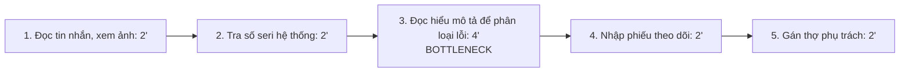
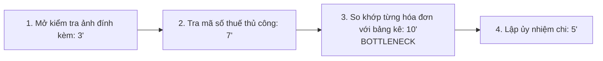
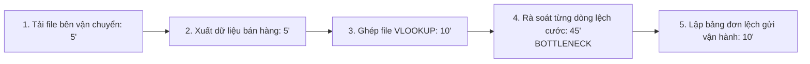

# Báo cáo cá nhân — 2A202603783_NguyenNhuDuyAn

> Đổi tên file theo quy tắc `MSSV_HoTen.md`, ví dụ `20241234_NguyenVanAn.md` (MSSV trước, dấu `_`, họ tên viết liền không dấu). Sửa cả dòng tiêu đề phía trên cho khớp.
> Template chi tiết và prompt mẫu cho từng mục: [docs/01-worksheet.md](../../docs/01-worksheet.md).
> Mỗi thành viên một file trong `report/individual/` trên repo nhóm: copy template này thành file mới, điền, rồi commit bằng tài khoản GitHub của bạn. Không viết hộ người khác.

## 1. Thông tin học viên

- Họ tên: Nguyễn Như Duy An
- MSSV: 2A202603783
- Email trường (không bắt buộc, repo có thể để public):
- Tên nhóm: D2
- Link repo nhóm: https://github.com/minhquannm0905-cloud/K5-L3B-Day02-D2-DiscoverProblemFraming

---

## 2. Scan problem (CP1)

Lăng kính: **Lặp lại** · **Tốn thời gian** · **Cần đọc, tổng hợp nhiều thông tin** · **Pain từ người khác**.

| # | Lăng kính | Job Story: Khi… tôi muốn… để… | Ai chịu ảnh hưởng? | Dấu hiệu thật (thời gian, tần suất, số người, bằng chứng) |
|---:|---|---|---|---|
| 1 | Lặp lại | Khi nhận danh sách đối soát tiền thu hộ (COD) từ đơn vị vận chuyển vào cuối ngày, tôi muốn đối chiếu mã vận đơn và tiền thực nhận với đơn hàng trên hệ thống nội bộ, để phát hiện các đơn lệch cước hoặc chưa thanh toán. | Kế toán, chủ cửa hàng | Xử lý 120 đến 150 đơn mỗi ngày, mất 75 phút kiểm tra file Excel. Tháng trước phát hiện trễ 3 đơn giao thành công nhưng bên vận chuyển chưa thanh toán 1,4 triệu đồng. |
| 2 | Tốn thời gian | Khi khách hàng gửi yêu cầu bảo hành kèm mô tả và ảnh chụp qua kênh nhắn tin, tôi muốn trích xuất số seri, phân loại mã lỗi phần cứng và gán người phụ trách, để phản hồi thời gian hẹn xử lý cho khách trong 15 phút. | Điều phối viên dịch vụ, kỹ thuật viên sửa chữa, khách hàng | Tiếp nhận 25 đến 30 ca mỗi ngày. Điều phối viên mất 8 đến 10 phút nhập liệu từng ca. Tuần trước có 4 ca phân công nhầm thợ do mô tả sơ sài, làm trễ hẹn 1 ngày. |
| 3 | Cần tổng hợp thông tin | Khi nhận hồ sơ mời thầu thiết bị kỹ thuật dài 50 trang, tôi muốn bóc tách toàn bộ thông số bắt buộc và điều kiện loại trừ, để lập bảng dự toán chào giá mà không bỏ sót tiêu chuẩn kỹ thuật. | Kỹ sư dự toán, nhân viên báo giá | Một bộ hồ sơ thầu mất 3 đến 4 tiếng rà soát. Đợt đấu thầu tháng trước sót tiêu chuẩn chống nước IP68 trong phụ lục, công ty bị phạt 18 triệu đồng để đổi lô vật tư tương đương. |
| 4 | Pain từ người khác | Khi tài xế giao hàng báo không gọi được người nhận, tôi muốn xác nhận nhanh địa chỉ và thời gian nhận mới từ khách mua hàng, để tài xế kịp giao lại đơn ngay trong ca làm việc. | Nhân viên CSKH, tài xế giao vận, người mua hàng | Tỷ lệ giao thất bại lần đầu chiếm 8% tổng lượng đơn (khoảng 35 đơn mỗi ca). Tài xế mất 12 phút gọi điện xác minh từng đơn. Bộ phận trực nhận 15 cuộc khiếu nại mỗi tuần về việc đơn bị hủy oan. |
| 5 | Lặp lại | Khi nhân viên gửi hồ sơ hoàn ứng chi phí công tác gồm 15 đến 20 ảnh chụp hóa đơn giấy và vé xe, tôi muốn đối soát tính hợp lệ của ngày xuất, mã số thuế và số tiền thanh toán, để duyệt phiếu chi trong ngày. | Kế toán thu chi, nhân viên thị trường | Mỗi tuần xử lý 18 bộ hồ sơ. Kế toán mất 25 phút rà soát từng ảnh chụp mờ hoặc kiểm tra trùng số hóa đơn. Tháng vừa rồi có 2 hóa đơn sai mã số thuế khiến thủ tục hoàn tiền bị trễ 5 ngày. |

**Ý AI gợi ý thêm:** Tự động dự đoán lượng hàng tồn kho và tự tạo đơn đặt nhà cung cấp.

**Xử lý:** Bỏ qua vì đây là giải pháp trá hình, ôm đồm và không gắn với bước nghẽn cụ thể nào đang xử lý bằng tay hàng ngày.
-

---

## 3. Top 3 Problem Cards + quy trình nháp (CP2)

### Bảng chọn top 3

| Rank | Problem | Vì sao chọn | Điều còn chưa chắc |
|---:|---|---|---|
| 1 | Phân loại yêu cầu bảo hành (#2) | Tần suất tiếp nhận cao, ảnh hưởng trực tiếp đến thời gian chờ của khách | Khách chụp ảnh tem vỡ hoặc mờ thì OCR có đọc được số seri không |
| 2 | Duyệt hóa đơn hoàn ứng công tác (#5) | Lặp lại hàng tuần, tốn thời gian kiểm tra thủ công, dễ sót lỗi thuế | Hóa đơn viết tay hoặc ảnh chụp nhàu nát có nhận diện được không |
| 3 | Đối soát tiền thu hộ COD (#1) | Quy trình lặp lại mỗi ngày, dữ liệu số rõ ràng, đo lường được ngay | Các đơn vị vận chuyển có xuất file đúng chuẩn định dạng không |

### Problem Card #1: Tiếp nhận và phân loại bảo hành thiết bị

| Trường | Nội dung |
|---|---|
| Job Story | Khi khách gửi yêu cầu bảo hành kèm mô tả và ảnh chụp qua tin nhắn, tôi muốn trích xuất số seri, phân loại mã lỗi phần cứng và gán thợ phụ trách, để phản hồi lịch hẹn xử lý cho khách trong 15 phút. |
| Actor | Điều phối viên dịch vụ khách hàng |
| Thời điểm / bối cảnh | Trong giờ hành chính khi khách gửi tin nhắn phản ánh sự cố kỹ thuật. |
| Quy trình hiện tại (3–7 bước) | 1. Đọc tin nhắn và xem ảnh khách gửi (2 phút)   2. Gõ lại số seri vào hệ thống để tra cứu bảo hành (2 phút)   3. Đọc mô tả để đoán linh kiện hỏng (4 phút)   4. Nhập phiếu sửa chữa vào bảng theo dõi (2 phút)   5. Nhắn tin gán việc cho kỹ thuật viên phù hợp (2 phút). |
| Bottleneck (bước nào, mất bao nhiêu phút) | Bước 3, phán đoán linh kiện hỏng từ mô tả của khách: mất 4 phút mỗi ca vì khách dùng từ ngữ không chuyên môn, điều phối viên phải hỏi lại nhiều lần. |
| Impact (nếu không giải thì sao) | 25 đến 30 ca mỗi ngày, tốn hơn 4 giờ nhập liệu; tuần trước có 4 ca chuyển nhầm thợ làm chậm tiến độ xử lý 1 ngày. |
| Success metric (baseline → target) | Thời gian tạo một phiếu bảo hành giảm từ 12 phút xuống dưới 4 phút; tỷ lệ phân công đúng thợ kỹ thuật đạt trên 90%. |
| Phương án không dùng AI | Tạo form mẫu cố định có sẵn danh sách chọn lỗi phần cứng để khách tự tích trước khi gửi. |
| Giả thuyết về AI (nếu có) | AI trích xuất số seri từ ảnh chụp phiếu bảo hành và phân loại mô tả lỗi thô của khách thành danh mục kỹ thuật. |
| Cảm nhận nhanh | Workflow |

Quy trình nháp hiện tại:

HIỆN TẠI: 12 phút/ca (khoảng 300 phút/ngày)

### Problem Card #2 - Đối soát hóa đơn hoàn ứng công tác

| Trường | Nội dung |
|---|---|
| Job Story | Khi nhân viên nộp hồ sơ hoàn ứng gồm 15 đến 20 ảnh chụp hóa đơn giấy và vé xe, tôi muốn đối soát tính hợp lệ của ngày xuất, mã số thuế và số tiền, để duyệt phiếu chi trong ngày. |
| Actor | Kế toán thanh toán nội bộ |
| Thời điểm / bối cảnh | Chiều thứ Sáu hàng tuần khi các bộ phận nộp đề nghị thanh toán. |
| Quy trình hiện tại | 1. Mở từng ảnh hóa đơn đính kèm (3') 2. Gõ tay mã số thuế lên trang Tổng cục Thuế để kiểm tra (7') 3. Đối chiếu số tiền trên từng hóa đơn với bảng kê nhân viên lập (10') 4. Lập ủy nhiệm chi (5') |
| Bottleneck | Bước 3, so khớp từng hóa đơn với bảng kê: mất 10 phút mỗi bộ vì ảnh chụp mờ hoặc thứ tự tải lên lộn xộn. |
| Impact | 18 bộ hồ sơ mỗi tuần, mất 7,5 giờ làm việc. Tháng trước có 2 hóa đơn sai mã số thuế làm chậm tiền hoàn ứng 5 ngày. |
| Success metric | Thời gian duyệt 1 bộ hồ sơ giảm từ 25 phút xuống dưới 8 phút. Không còn hóa đơn sai mã số thuế lọt qua khâu duyệt. |
| Phương án không dùng AI | Bắt buộc nhân viên tự tra cứu mã số thuế và nộp file XML hóa đơn điện tử thay vì gửi ảnh chụp. |
| Giả thuyết về AI | OCR đọc mã số thuế và số tiền từ ảnh rồi tự so khớp với bảng kê. |
| Cảm nhận nhanh | Workflow |

Quy trình nháp hiện tại:

HIỆN TẠI: 25 phút/bộ hồ sơ

### Problem Card #3 - Đối soát tiền thu hộ (COD)

| Trường | Nội dung |
|---|---|
| Job Story | Khi nhận danh sách đối soát COD từ đơn vị vận chuyển vào cuối ngày, tôi muốn đối chiếu mã vận đơn và tiền thực nhận với đơn hàng trên hệ thống nội bộ, để phát hiện các đơn lệch cước hoặc chưa thanh toán. |
| Actor | Kế toán đối soát công nợ |
| Thời điểm / bối cảnh | Cuối giờ chiều mỗi ngày làm việc, sau khi bên giao hàng gửi bảng kê. |
| Quy trình hiện tại | 1. Tải file Excel từ bên vận chuyển (5') 2. Xuất dữ liệu bán hàng nội bộ (5') 3. Dùng VLOOKUP ghép 2 bảng (10') 4. Rà soát từng dòng lệch tiền hoặc sai trạng thái (45') 5. Lập danh sách đơn lệch gửi bộ phận vận hành (10') |
| Bottleneck | Bước 4, rà soát nguyên nhân từng dòng lệch: mất 45 phút vì phải mở chi tiết từng đơn xem lệch do mã giảm giá hay do phí lưu kho. |
| Impact | Mất 75 phút mỗi ngày cho 1 kế toán. Tháng trước sót 3 đơn giao thành công nhưng chưa nhận thanh toán 1,4 triệu đồng. |
| Success metric | Thời gian đối soát giảm từ 75 phút xuống dưới 20 phút mỗi ngày. Tỷ lệ phát hiện đơn lệch tiền đạt 100%. |
| Phương án không dùng AI | Viết script Excel hoặc Python tự động so khớp cột mã đơn và tiền cước, xuất ra các dòng lệch. |
| Giả thuyết về AI | AI đọc cột ghi chú lý do của bên vận chuyển để phân loại nguyên nhân lệch tiền vào nhóm cố định. |
| Cảm nhận nhanh | Rule kết hợp Workflow |

Quy trình nháp hiện tại:

HIỆN TẠI: 75 phút/ngày

### Card muốn pitch nhất

-- Card số: 3 (Đối soát tiền thu hộ COD)
- Vì sao: Quy trình có số liệu thời gian thật (75 phút mỗi ngày) và thiệt hại tài chính rõ ràng (tháng trước sót 3 đơn lệch 1,4 triệu đồng). Bài này phân định ranh giới rất sạch giữa việc dùng Rule logic và điểm cần AI.
- Câu hỏi muốn nhóm phản biện: Nếu viết script bằng Rule đã lọc được 85% đơn chuẩn, thì việc đưa thêm AI vào đọc ghi chú lệch cước có đáng chi phí phát triển so với việc để kế toán tự xem 15% còn lại không?

### AI đã phản biện card thế nào

| Điểm yếu AI chỉ ra | Đồng ý? | Đã sửa gì |
|---|---|---|
| Khâu so khớp mã đơn và tiền là dữ liệu số có cấu trúc, dùng AI ở đây là lãng phí và dễ gây sai số. | Đồng ý | Giữ nguyên bước so khớp bằng Rule hoặc script; chỉ xem xét dùng AI cho bước đọc hiểu văn bản ghi chú lý do của đối tác giao hàng. |
| Giả định ngầm là mọi đối tác giao hàng đều xuất file theo đúng một mẫu cột. | Đồng ý một phần | Đưa việc cấu trúc file khác nhau giữa các bên vào danh sách giả định cần kiểm chứng ở CP4. |
| Đề xuất AI tự động gửi email khiếu nại sang hãng vận chuyển mà không cần người xem lại. | Không đồng ý | Giữ ranh giới kiểm soát: Kế toán bắt buộc phải duyệt danh sách đơn lệch trước khi gửi ra bên ngoài. |

---

## 4. Tôi đã tham gia phần nào (CP3 → CP7)

| Hoạt động | Tôi đã làm gì? | Kết quả / ảnh hưởng tới bài nhóm |
|---|---|---|
| Pitch Problem Card | Pitch Card về "Đối soát tiền thu hộ COD" cho kế toán bán hàng. | Nhóm ghi nhận đây là bài toán có số liệu tài chính rõ ràng nhưng quy trình thiên nhiều về logic cố định (Rule). |
| Phản biện bài của bạn khác | Câu hỏi tôi đã đặt: "Nếu nhóm trưởng hoặc giảng viên ghim các thông báo quan trọng lên đầu nhóm chat và tạo sẵn thư mục Google Drive theo môn, liệu có giải quyết được vấn đề tìm kiếm mà không cần dùng công cụ nào không?" | Bạn phụ trách đề xuất đã làm rõ: Dù có ghim tin nhắn, số lượng thông báo dồn dập trong tuần thi vẫn làm trôi thông tin, học viên vẫn mất thời gian mở từng file xem nội dung bên trong |
| Nhận phản biện | Câu hỏi tôi nhận được: "Bài đối soát COD có thực sự cần AI không hay chỉ cần viết hàm Excel là giải quyết được 90%?" | Tôi đã sửa gì: Thừa nhận bước so khớp mã đơn chỉ cần dùng Rule, và đồng thuận cùng nhóm chuyển hướng sang bài toán tìm kiếm thông tin môn học vì có mức độ mơ hồ cao hơn. |
| Gom cluster / cây OST | Cùng nhóm gom các đề xuất tìm tài liệu, tìm quyết định cũ vào nhóm "Tìm kiếm và truy xuất thông tin phân tán". | Xây dựng nhánh cơ hội (Opportunity) tập trung vào việc giảm thời gian đọc lướt nội dung trước giờ lên lớp. |
| Chọn candidate problem | Tham gia chấm điểm 7 tiêu chí cho 3 bài trong danh sách rút gọn. | Thống nhất chọn bài "Tìm lại thông báo và tài liệu môn học" vì tính gần gũi và dễ dàng khảo sát sinh viên trong lớp. |
| Kiểm chứng / research | Phỏng vấn nhanh 2 học viên trong lớp về thói quen tìm tài liệu trước giờ kiểm tra; hỗ trợ tìm kiếm tài liệu về các bot thông báo trên Discord/Telegram. | Xác nhận bước nghẽn lớn nhất không phải là tìm link, mà là đọc lướt để biết tài liệu đó có đúng yêu cầu cần nộp hay không. |
| Quy trình nhóm | Đóng góp ý kiến để vẽ quy trình trước và sau khi có giải pháp xử lý thông báo. | Bổ sung thêm bước sinh viên tự đối chiếu lại với file gốc, tránh việc phụ thuộc hoàn toàn vào tóm tắt tự động. |
| Problem Statement | Cùng nhóm hoàn thiện bản v0 và tinh chỉnh lên bản v1. | Bổ sung ranh giới an toàn (boundary): công cụ không được tự ý gửi tin nhắn thay sinh viên. |
| Mức can thiệp AI | Phân tích tính khả thi giữa Rule và Workflow. | Thống nhất chọn mức Workflow: Rule để lọc từ khóa và phân loại môn học, AI để trích xuất các mốc hạn chót từ văn bản dài. |
| Quyết định | Đánh giá 4 rủi ro sản phẩm (Value, Usability, Feasibility, Viability). | Đồng thuận ra quyết định Not Yet vì bài toán gặp rủi ro Feasibility và Viability cao (chưa có API trích xuất tin nhắn chat an toàn và vướng quyền riêng tư của sinh viên). |

---

## 5. Dùng AI

| Checkpoint | Tôi dùng AI để làm gì? | AI hữu ích ở đâu? | AI sai hoặc hời hợt ở đâu? | Tôi sửa gì bằng nhận định của mình? |
|---|---|---|---|---|
| CP1 Scan | Tìm thêm góc nhìn về các vấn đề vận hành lặp lại. | Gợi ý được tình huống rà soát hóa đơn công tác. | Gợi ý ý tưởng "tự động quản lý chuỗi cung ứng bằng AI", đây là giải pháp trá hình và quá rộng. | Loại bỏ hoàn toàn ý tưởng chuỗi cung ứng, giữ lại các việc thực tế đo được bằng phút. |
| CP2 Problem Card | Đưa ra gợi ý về kẽ hở trong card đối soát COD. | Chỉ ra việc so khớp số tiền là bài toán dữ liệu có cấu trúc, không nên lạm dụng AI. | Đề xuất để AI tự gửi khiếu nại sang hãng vận chuyển mà không cần người duyệt. | Bổ sung ranh giới bắt buộc: kế toán phải xác nhận danh sách lệch trước khi gửi khiếu nại. |
| CP4 Research | Tìm kiếm các giải pháp quản lý tài liệu học tập tự động cho sinh viên. | Liệt kê nhanh tính năng tìm kiếm của Notion AI và các bot Discord mã nguồn mở. | Đưa ra một số liên kết tài liệu đã cũ và không truy cập được. | Tự mở kiểm tra từng trang tài liệu, chỉ giữ lại các giải pháp có dẫn chứng thực tế. |
| CP5 Quy trình | Chuyển mô tả các bước thành khối mã sơ đồ trực quan. | Tạo khung sơ đồ nhanh chóng, đúng thứ tự các bước. | Gộp bước "mở đọc tài liệu" và "ghi lại yêu cầu" thành một bước duy nhất, làm mất bước nghẽn chính. | Tách riêng hai bước và gắn lại thời gian đo lường thực tế. |
| CP5–6 Problem Statement | Rà soát lỗi câu từ trong bản Problem Statement. | Phát hiện câu chữ bị dài dòng ở phần tác động (impact). | Đề xuất viết gộp giải pháp kỹ thuật vào phần mô tả vấn đề. | Giữ nguyên nguyên tắc mô tả vấn đề thuần túy, không đưa tên công cụ hay thuật toán vào. |
| CP6 Mức can thiệp / quyết định | So sánh ưu nhược điểm giữa Rule và Workflow. | Cung cấp góc nhìn về chi phí tính toán khi chạy mô hình ngôn ngữ lớn. | Khuyên dùng hệ thống tự hành (Agent) nhiều bước phức tạp. | Bác bỏ phương án Agent, chọn Workflow kết hợp Rule để tiết kiệm chi phí và giữ quyền kiểm soát cho người dùng. |

---

## 6. Reflection (CP7)

Trả lời bằng trải nghiệm thật của bạn, tối thiểu 200 từ cho các câu 6.1–6.6 (không tính 6.7, câu này được chấm riêng ở tiêu chí C5). **Không dùng AI để viết thay.**

**6.1. Tôi học được gì khi nghe top 3 problems của các bạn khác?**

Tôi nhận ra các vấn đề tìm kiếm thông tin phân tán xuất hiện rất nhiều trong đời sống. Ban đầu tôi nghĩ phải chọn bài toán có thiệt hại tiền bạc như đối soát COD mới đáng làm. Khi nghe bạn trình bày việc mất từ 3 đến 5 phút trước mỗi buổi học chỉ để lục lại file thông báo bị trôi, tôi thấy đây là nỗi đau có tần suất lặp lại rất cao. Việc chọn đề tài gần gũi giúp cả nhóm dễ dàng tiếp cận người dùng thật để phỏng vấn thay vì phải suy đoán quy trình của doanh nghiệp bên ngoài.

**6.2. Nhóm có lúc nào bị "solution-first" (nghĩ giải pháp trước khi hiểu vấn đề) không? Lúc đó nhóm nhận ra và xử lý thế nào?**

Nhóm tôi rơi vào bẫy này ngay đầu buổi thảo luận Checkpoint 3. Vừa nghe xong đề xuất tìm thông báo, cả nhóm lập tức bàn việc lập bot Telegram hay dùng mô hình ngôn ngữ lớn để trả lời tự động. Nhóm nhận ra khi nhìn vào cây Opportunity Solution Tree: toàn bộ các nhánh đều chứa tên công cụ thay vì nhu cầu của người dùng. Nhóm đã dừng lại, gạch bỏ tên công cụ và viết lại các nhánh tập trung vào khó khăn thật: sinh viên bị trôi tin nhắn và mất thời gian đọc lướt để tìm hạn nộp.

**6.3. Tôi có đổi ý sau khi bị phản biện không? Kể một lần cụ thể.**

Tôi đổi ý về việc bảo vệ bài toán đối soát COD. Ban đầu tôi nghĩ bài này thuyết phục vì có số liệu thiệt hại 1,4 triệu đồng rõ ràng. Khi nhóm chất vấn: "Nếu chỉ cần viết script Excel so khớp hai cột là giải quyết được phần lớn công việc, tại sao phải dùng AI?", tôi nhận ra mình đang cố gượng ép công nghệ vào quy trình vốn dĩ giải quyết tốt nhất bằng logic cố định. Tôi chủ động rút lui bài toán của mình và đồng thuận chọn bài tìm tài liệu vì có độ mơ hồ cao hơn trong khâu đọc hiểu nội dung.

**6.4. Kết quả kiểm chứng (phỏng vấn/survey/research) có làm tôi bất ngờ không? Điều gì?**

Điều làm tôi bất ngờ là sinh viên không hề thiếu nơi lưu trữ tài liệu. Giảng viên đã tải bài giảng lên hệ thống trường, nhưng sinh viên vẫn bị lỡ việc do các thông báo đổi phòng học hoặc hạn nộp bài thường gửi qua nhóm chat trao đổi nhanh. Khi phỏng vấn, một bạn cho biết bạn không cần công cụ đọc hộ toàn bộ bài giảng, bạn chỉ cần một dòng tóm tắt yêu cầu nộp bài trước khi vào lớp. Điều này giúp nhóm nhận ra giá trị cốt lõi là bóc tách việc cần làm, không phải tóm tắt tài liệu học thuật dài dòng.

**6.5. Điều khó nhất khi viết Problem Statement là gì?**

Khó nhất là không đưa giải pháp vào mô tả vấn đề và đặt metric đo lường được bằng hành vi thật. Cả nhóm rất dễ có xu hướng viết các từ chung chung như "giúp sinh viên tiện lợi hơn". Nhóm phải sửa lại Success Metric thành: giảm thời gian tìm đúng tài liệu từ 3 đến 5 phút xuống dưới 2 phút, đo bằng cách tự bấm giờ trong 4 lần chuẩn bị bài tiếp theo.

**6.6. Nếu làm lại, tôi sẽ đổi gì? Tôi sẽ phản biện nhóm mạnh hơn ở điểm nào?**

Nếu làm lại, tôi sẽ yêu cầu nhóm bấm giờ thực tế ngay trong buổi học thay vì dùng số ước tính. Tôi cũng sẽ phản biện mạnh hơn về rào cản kỹ thuật lấy tin nhắn từ ứng dụng chat. Các nền tảng như Zalo hay Messenger không mở API đọc tin nhắn cá nhân tự do. Nếu nhóm làm rõ điểm nghẽn kỹ thuật này sớm hơn, nhóm sẽ không mất nhiều thời gian bàn về giải pháp tích hợp bot chat tự động.

**6.7. Hiểu bài:** 

Bài toán xuất phát từ việc sinh viên mất 3 đến 5 phút trước mỗi buổi học để tìm lại thông báo và file tài liệu bị trôi trong nhóm chat. Quy trình hiện tại gồm 5 bước: mở chat, cuộn tìm tin, tải tài liệu, đọc lướt nội dung và ghi lại yêu cầu cần làm. Chỉ số đo lường là giảm thời gian tìm đúng tài liệu xuống dưới 2 phút và tỷ lệ bỏ sót yêu cầu giảm về 0%. Ranh giới quy định công cụ chỉ đọc tài liệu trong kênh thông báo công khai được chỉ định, không tự gửi tin nhắn hay nộp bài thay sinh viên, và người dùng luôn phải tự đối chiếu lại với file gốc. Nhóm chọn mức Workflow: Rule lọc tin nhắn theo từ khóa môn học, AI hỗ trợ trích xuất hạn chót và việc cần nộp. Quyết định cuối cùng là Not Yet vì hai rào cản lớn: thiếu API lấy dữ liệu tin nhắn an toàn từ các ứng dụng chat phổ biến và sinh viên chưa sẵn sàng chia sẻ quyền đọc tin nhắn nhóm nội bộ. Nhóm đặt ngưỡng dừng: kiểm chứng kỹ thuật trên Discord hoặc Telegram trong 1 tuần; nếu không tìm được phương án đọc dữ liệu an toàn hoặc sinh viên từ chối, nhóm chuyển sang No-Go và quay về giải pháp ghim thông báo cùng quy ước lưu trữ drive cố định.

## 7. Tài liệu tham khảo

- Intercom: Jobs to be Done & Job Stories framework.

- Teresa Torres: Continuous Discovery Habits (Opportunity Solution Tree).

- Rob Fitzpatrick: The Mom Test.

- Marty Cagan: Inspired - Four Big Risks framework.

